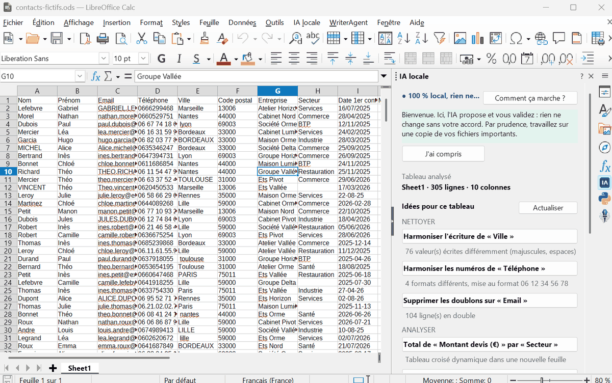
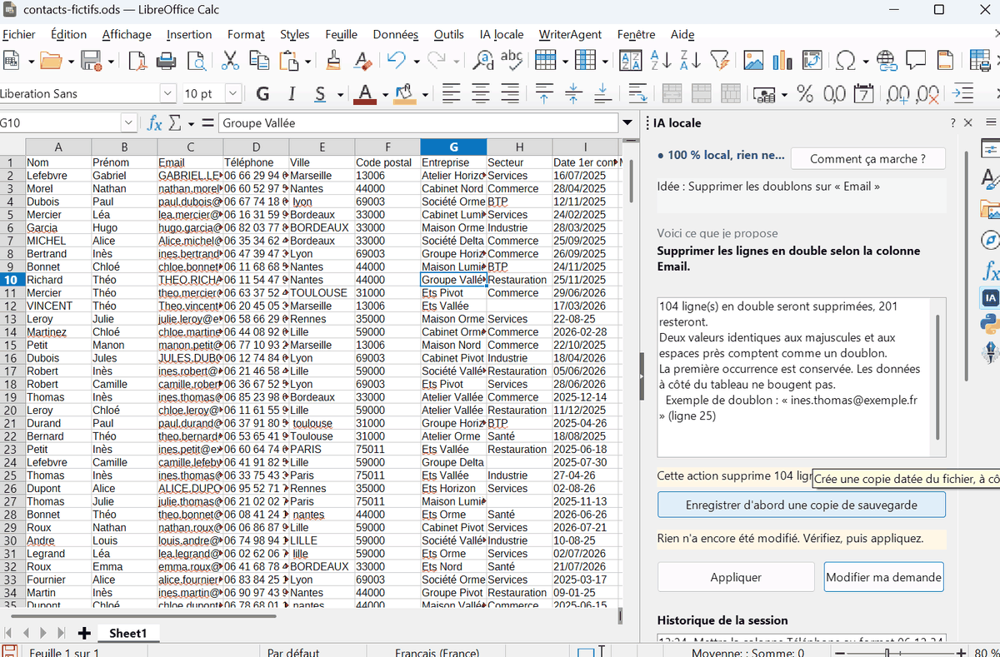
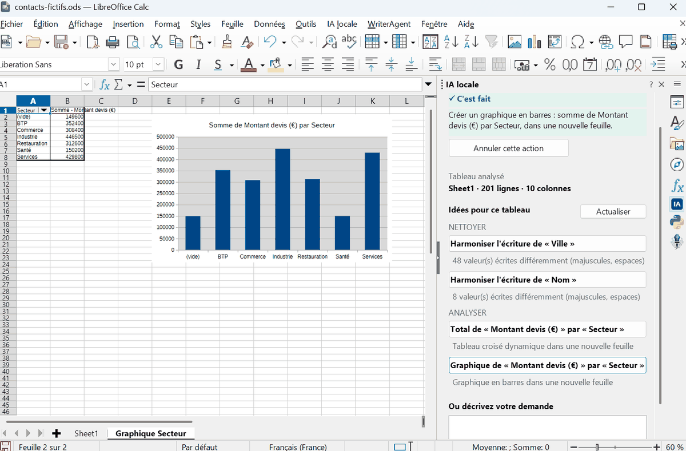

# Guide d'installation et d'utilisation

Pour toute personne qui veut essayer, même sans connaître l'IA. Comptez une dizaine de minutes.

## Avant de commencer, deux précautions

- Faites l'essai sur une copie de vos fichiers, ou avec le fichier d'exemple fourni (`exemples/contacts-fictifs.ods`).
- Gardez à l'esprit que c'est une preuve de concept : utile pour découvrir et tester, pas encore pour un usage critique.

## Étape 1 : installer Ollama

Ollama est le logiciel libre qui fait tourner le modèle d'IA sur votre ordinateur.

1. Allez sur [ollama.com/download](https://ollama.com/download) et téléchargez la version de votre système.
2. Lancez l'installation, puis Ollama. Sous Windows, une petite icône apparaît près de l'horloge.

Ollama tourne ensuite discrètement en arrière-plan. Il n'est accessible que depuis votre propre ordinateur.

## Étape 2 : installer l'extension

1. Téléchargez le fichier `.oxt` de la dernière version (par exemple `calc-ia-locale-0.4.2.oxt`) dans la page Releases du dépôt GitHub.
2. Facultatif mais conseillé : vérifiez son empreinte (voir [SECURITE.md](SECURITE.md)).
3. Double-cliquez sur le fichier. LibreOffice propose de l'installer : acceptez.
4. Fermez complètement LibreOffice, puis rouvrez-le.

Sous Linux, si l'extension ne s'installe pas, ajoutez le paquet `libreoffice-script-provider-python`.

## Étape 3 : ouvrir le panneau et télécharger le modèle

1. Ouvrez un tableau dans Calc.
2. Cliquez sur l'icône « IA » de la barre d'outils, ou sur le menu *IA locale > Ouvrir le panneau IA locale*.
3. Le panneau vérifie votre installation. S'il manque le modèle, cliquez sur « Télécharger le modèle » (environ 3 Go, une seule fois). La progression s'affiche.

Une fois le modèle téléchargé, Internet n'est plus nécessaire.

## Utiliser l'assistant

**Les idées.** Le panneau lit votre tableau et propose ce qui peut être amélioré ou analysé. Cliquez sur une idée. Une proposition chiffrée s'affiche, et rien n'est encore modifié.

**Une demande libre.** Écrivez ce que vous voulez, avec vos mots, par exemple « moyenne des devis par ville », puis cliquez sur Proposer. Le panneau vous dit ce qu'il a compris.

**Vérifier, puis appliquer.** Lisez l'aperçu, avec le nombre de cellules modifiées, des exemples et les avertissements. Si l'action supprime ou modifie des données, le panneau le signale et propose d'enregistrer une copie de sauvegarde. Cliquez ensuite sur Appliquer.

**Revenir en arrière.** Le bouton « Annuler cette action » rétablit l'état précédent.

**Comprendre.** Le bouton « Comment ça marche ? » rappelle ce que fait l'IA, ce qui reste sur votre PC, les précautions et les limites.

## Questions courantes

**Mes données partent-elles sur Internet ?**
Non. L'extension ne parle qu'à Ollama sur votre ordinateur, et refuse toute autre adresse. Pour le vérifier, coupez le Wi-Fi, tout continue de fonctionner.

**L'IA voit-elle le contenu de mes cellules ?**
Non. Elle ne reçoit que les noms des colonnes et votre phrase.

**Et si l'IA se trompe ?**
Ça peut arriver sur un détail. C'est pour cela que rien ne s'applique sans votre validation, que l'aperçu est détaillé et que chaque action s'annule.

**Mes formules risquent-elles d'être effacées ?**
Non. Les cellules qui contiennent une formule ne sont jamais modifiées, et l'aperçu le signale.

**Le panneau indique « Ollama absent ».**
Lancez Ollama depuis le menu Démarrer, puis cliquez sur « Vérifier à nouveau ».

**Mon ordinateur a 8 Go de mémoire.**
Choisissez le modèle `qwen3:1.7b` dans le champ « Modèle » en bas du panneau, puis téléchargez-le. Il est plus léger, un peu moins précis.

**Le panneau n'apparaît pas.**
Vérifiez dans *Outils > Gestionnaire des extensions* que l'extension est activée, puis redémarrez complètement LibreOffice.

**Pourquoi le modèle Qwen, d'Alibaba ?**
Parce que c'est celui qui a obtenu les meilleurs résultats sur notre banc d'essai, sous une licence réellement libre (Apache 2.0). Il tourne entièrement sur votre PC et n'a aucun accès à Internet. Vous pouvez choisir un autre modèle dans le panneau.

## Désinstaller

Dans LibreOffice, *Outils > Gestionnaire des extensions*, sélectionnez « IA locale pour Calc » puis Supprimer. Ollama se désinstalle comme n'importe quel logiciel. Le seul fichier laissé par l'extension est `.calc-ia-locale.json` dans votre dossier personnel.
